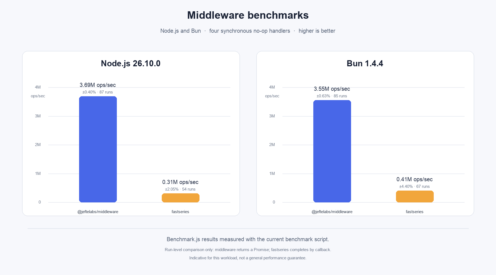

# @jeftelabs/middleware

Implementação leve e independente de framework da **Chain of Responsibility** (pipeline de middleware) em TypeScript. Registre handlers em ordem, defina como cada item será executado e avance a cadeia chamando `next()`.



Os números são medições locais de uma cadeia de quatro handlers sem operação. O benchmark compara APIs com modelos diferentes (Promise e callback) e é apenas indicativo para esse workload; veja [metodologia e limitações](docs/guides/benchmarks.md).

## Instalação

```sh
npm install @jeftelabs/middleware
# ou
bun add @jeftelabs/middleware
```

O pacote publica ESM compilado e declarações TypeScript. Compatibilidade de runtime, execução da suíte e build estão detalhados em [Desenvolvimento](docs/references/development.md).

## Uso básico

```ts
import Middleware from '@jeftelabs/middleware'
import type { NextFn } from '@jeftelabs/middleware/types'

type Context = { trace: string[] }
type Handler = (context: Context, next: NextFn) => void | Promise<void>

const context: Context = { trace: [] }
const pipeline = new Middleware<Handler>()

pipeline.add(async (ctx, next) => {
  ctx.trace.push('antes: autenticação')
  await next()
  ctx.trace.push('depois: autenticação')
})

pipeline.add(async (ctx, next) => {
  ctx.trace.push('endpoint')
  await next()
})

await pipeline.runner().run((handler, next) => handler(context, next))
// trace: autenticação → endpoint → depois: autenticação
```

O executor recebe o handler e `next` e decide quais argumentos passar. Assim, os handlers podem ser funções, objetos ou outros valores; por exemplo, adapte objetos com método `handle` no executor:

```ts
type HandlerObject = { handle(context: Context, next: NextFn): void | Promise<void> }
const objects = new Middleware<HandlerObject>()
objects.add({ handle: async (ctx, next) => { ctx.trace.push('objeto'); await next() } })
await objects.runner().run((item, next) => item.handle(context, next))
```

## Regras importantes

- `add` preserva ordem e ignora o mesmo objeto/função registrado mais de uma vez (identidade de referência).
- Criar um runner congela a pilha. Alterações posteriores via `add`, `remove`, `clear` ou `merge` lançam erro.
- Cada `next()` avança no máximo uma vez. Faça `await next()` ou retorne `next()` para preservar a conclusão assíncrona e a ordem de retorno dos handlers.
- Um handler que não chama `next()` encerra a cadeia: os handlers seguintes e o `finalHandler` não executam.
- `finalHandler` é executado quando todos os handlers chamam `next()` até o fim.
- Erros propagam por padrão. `errorHandler` pode tratá-los; o fluxo retorna aos handlers upstream, mas os handlers downstream após o erro não são retomados automaticamente.
- Um `Runner` representa uma execução. Para reutilizar a pilha, chame `middleware.runner()` novamente; não reutilize o mesmo runner em execuções concorrentes.

## Handler final e erros

```ts
const runner = pipeline.runner()
  .finalHandler(async () => {
    context.trace.push('fim da cadeia')
  })
  .errorHandler(async (error) => {
    context.trace.push(`erro tratado: ${error.message}`)
    return 'recuperado'
  })

const result = await runner.run((handler, next) => handler(context, next))
```

`run()` resolve com o valor retornado pelo `finalHandler` ou pelo tratamento de erro, quando houver; sem valor explícito, resolve como `undefined`. Se não configurar `errorHandler`, a Promise de `run()` rejeita com o erro.

## Node.js e Bun

Os scripts de validação em ambos os runtimes:

```sh
npm test
npm run typecheck
npm run build

bun run test:bun
bun run typecheck
bun run build:bun
```

Benchmarks:

```sh
npm run benchmark
bun run benchmark:bun
```

## Documentação

Consulte o [índice de documentação](docs/README.md) para guias, arquitetura, referências de API, desenvolvimento e benchmarks.

## Licença

MIT — veja [LICENSE](LICENSE).
